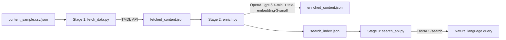

# AI-Powered Content Discovery

[](https://github.com/alessandrograssi10/ai-content-discovery/actions/workflows/ci.yml)

A three-stage pipeline that fetches movie/TV metadata, enriches it with AI-generated
structured metadata, and exposes a natural-language semantic search API over the
resulting catalog.



## Setup

Requires Python 3.11+, a TMDb API key, and an OpenAI API key.

```bash
python -m venv .venv
source .venv/bin/activate          # Windows: .venv\Scripts\activate
pip install -r requirements.txt
cp .env.example .env
```

Edit `.env` with your keys:

- `TMDB_API_KEY` — the TMDb **v4 Read Access Token** (the long JWT-style string,
  not the short v3 API key — the two are not interchangeable; see
  `src/services/tmdb_client.py` for the auth method used).
  Get it from [themoviedb.org/settings/api](https://www.themoviedb.org/settings/api).
- `OPENAI_API_KEY` — requires a funded OpenAI account (no automatic free trial
  credits as of 2025). Total cost to run this project end-to-end is a few cents:
  `gpt-5.4-mini` and `text-embedding-3-small` are both among OpenAI's cheapest models.

## Running the pipeline

Run the three stages in order:

```bash
python -m src.fetch_data      # Stage 1: TMDb fetch -> output/fetched_content.json
python -m src.enrich          # Stage 2: AI enrichment -> output/enriched_content.json, output/search_index.json
uvicorn src.search_api:app --reload   # Stage 3: search API on http://localhost:8000
```

Then open `http://localhost:8000/docs` for the interactive Swagger UI, or query directly:

```bash
curl "http://localhost:8000/search?q=movies+about+dreams+or+alternate+realities&top_k=5"
```

## Sample queries and results

Real output from the running system (not hand-picked or edited):

**Query: "movies about dreams or alternate realities"**
| Rank | Title | Score |
|---|---|---|
| 1 | Inception | 0.4318 |
| 2 | Spirited Away | 0.3851 |
| 3 | Mad Max: Fury Road | 0.3546 |
| 4 | Suspiria | 0.3502 |
| 5 | Coherence | 0.3457 |

**Query: "something funny and real"**
| Rank | Title | Score |
|---|---|---|
| 1 | The Office | 0.3286 |
| 2 | Amélie | 0.2682 |
| 3 | Funny Games | 0.2635 |
| 4 | Fleabag | 0.2619 |
| 5 | Parasite | 0.2560 |

**Query: "dark psychological horror"**
| Rank | Title | Score |
|---|---|---|
| 1 | Suspiria | 0.5504 |
| 2 | Get Out | 0.4663 |
| 3 | Funny Games | 0.4411 |
| 4 | Coherence | 0.3971 |
| 5 | The Dark Knight | 0.3809 |

See "Known limitations" below for an honest read of the imperfect rankings in
queries 1 and 2 (Coherence and Mad Max in query 1; Parasite ranking below
expectations elsewhere).

## Running the evaluation

```bash
# with the server already running
python -m eval.run_eval
```

Uses `eval/golden_queries.json` (8 hand-built queries, including the three sample
queries shown above) and reports two metrics per query:

- **R-Precision**: precision computed at k=R, where R is the number of relevant
  items expected for *that specific query* — not a fixed k=5 for every query.
  Chosen deliberately over a fixed Precision@5: this catalog has only 21 titles
  and R varies from 1 to 3 across the golden set. A fixed Precision@5 would cap
  a query expecting only 1 relevant title at 0.20 even with a perfect top-1
  result — a false floor unrelated to actual search quality. R-Precision does
  not have this problem, at the cost of being stricter about *where* in the
  ranking a correct result appears (a correct match ranked just below position
  R is penalized here even though a fixed-window Recall@5 would still count it).
- **Recall@5**: kept as a fixed top-5 window, since it does not suffer from the
  same ceiling issue (it can reach 1.0 regardless of R).

**Results on the current catalog: Avg R-Precision = 0.77, Avg Recall@5 = 0.88.**

## Running tests

```bash
pip install -r requirements-dev.txt
ruff check .
pytest
```

The suite makes no calls to TMDb or OpenAI and needs no API keys: unit tests
cover the Pydantic schemas, the TMDb matching cascade (against an in-memory
HTTP transport) and the embedding text builder; API tests run the real FastAPI
app and the committed `search_index.json` with a fake LLM client in place of
OpenAI. CI runs lint and tests on every pull request and on every push to `main`.

## Design decisions

### Why TMDb
De-facto standard for this kind of project: free for non-commercial use, no
meaningful rate limit (removed in 2019), and — unlike OMDb — has solid TV show
coverage in addition to movies, which matters since 5 of the 21 seed titles are
TV series. IMDb was not a real option: no free public API, official access
starts at $150k+/year via AWS Data Exchange.

### Why a single provider (OpenAI) for both enrichment and embeddings
Anthropic has no native embedding model (it recommends Voyage AI as a
third-party partner), which would mean managing two providers instead of one.
Consolidating on OpenAI removes that complexity for a time-boxed prototype.

### Why no LangChain
Direct SDK calls keep every request fully inspectable and explainable line by
line instead of relying on
a framework's abstraction over what is actually being sent to the model.

### Why gpt-5.4-mini (not gpt-5.4-nano)
Enrichment requires some judgment (inferring mood and themes, not pure
extraction), and at only 21 titles the cost difference between the two tiers is
a fraction of a cent — irrelevant, so quality margin was chosen over marginal
savings. (Note: the originally planned `gpt-4o-mini` was retired when the
GPT-5.4 family launched in March 2026.)

### Why JSON files instead of a database, and embeddings inline instead of pgvector
For a 21-item catalog, a database is infrastructure without a matching benefit.
`output/search_index.json` is loaded into memory once at server startup and
searched with an in-memory numpy matrix — see "Why raw numpy" below. At a
catalog of thousands or millions of titles, this would move to pgvector or a
dedicated vector store (Pinecone, Weaviate) for persistence, incremental
updates, and approximate nearest-neighbor search at scale.

### Why two output files instead of one
`output/enriched_content.json` (the main output) excludes the embedding field —
a 1536-number vector per item would make the file unreadable for a human
reviewer, and embeddings are not part of the metadata schema.
`output/search_index.json` is an internal artifact with embeddings included,
used only by Stage 3 to avoid recomputing embeddings on every server restart.
Both are written from the same in-memory list in the same script run, so
duplication risk between them is minimal.

### Why raw numpy cosine similarity instead of a library (ChromaDB, FAISS, scikit-learn)
Deliberate transparency choice: implementing cosine similarity by hand (a few
lines — normalize once at startup, then a single matrix-vector dot product per
query) means every step of the search mechanism is derivable and explainable
in an interview, rather than delegated to a library's internals. Libraries like
ChromaDB are explicitly well-suited to this exact prototype scale, and were
considered — this is a deliberate trade of a small amount of engineering
convenience for full explainability, not unfamiliarity with the alternative.
At 21 items, "brute-force" comparison against every item is also simply the
correct engineering call (no indexing structure is needed at this scale).

### Fetch logic: a 4-step cascade, not `/search/multi`
The fetch logic tries, in order: `/search/movie` with a year filter,
`/search/tv` with a year filter, then both again without a year filter — with
an exact title match (case-insensitive) plus a 1-year tolerance as the
acceptance criterion at every step. This was arrived at empirically, not
designed upfront:

- **`/search/multi` (a single endpoint covering movies, TV, and people) was
  tested as an alternative** and scored 20/21 on the seed, missing "8½" — TMDb
  staff confirmed `/search/multi` uses a different ranking algorithm ("ngram"
  search, tuned for autocomplete) than `/search/movie`/`/search/tv` (which
  default to "phrase" search, a more literal match). No parameter was found to
  force `/search/multi` into phrase mode. The 4-step cascade, using
  phrase-search endpoints throughout, scored 21/21.
- **A hybrid (fast-path `/search/multi` with the cascade as fallback) was also
  built and tested.** It closed the coverage gap but added real complexity
  (two separate search code paths, an extra parameter to reconcile differing
  result shapes) for a benefit — saving one API call per title in the common
  case — that is irrelevant at this catalog size (TMDb has no meaningful rate
  limit). Reverted in favor of the simpler cascade.
- **Fuzzy title scoring (`difflib.SequenceMatcher`) was implemented as a
  safety net for near-miss titles**, then empirically found to contribute
  **zero accepted matches** across all 21 titles — every title was resolved by
  an exact match at some point in the cascade (confirmed: every row of the
  validation run showed a 1.00 match ratio). Removed for the same reason as
  the hybrid above: complexity without a demonstrated benefit on this dataset.
  A larger, messier real-world catalog would likely need this safety net back.
- **1-year tolerance** is calibrated on real data, not arbitrary: three titles
  (Casablanca, Funny Games, Coherence) showed exactly a 1-year discrepancy
  between the seed and TMDb's recorded date. Verified historically for
  Casablanca: a limited premiere on Nov 26, 1942 in New York, with the US
  national release on Jan 23, 1943 — TMDb records the latter.

Full rationale and code-level comments: `src/services/tmdb_client.py`.

### Why deterministic embeddings-based search, not LLM-based ranking
The search stage is pure retrieval (embed the query, compare against
precomputed catalog embeddings via cosine similarity) rather than asking an
LLM to rank or select matches directly. This is deterministic, fast, and cheap
— it only calls an LLM once per query (to embed it), not once per catalog item.
An LLM-based ranking fallback for queries where no result clears the similarity
threshold was considered (potentially useful for complex or negated queries
that pure embeddings handle poorly) but not built, to keep the first
version simple — see "With more time" below.

### Why the similarity threshold is 0.25
Calibrated empirically, not guessed: across the golden query set, the lowest
score among genuinely correct matches was 0.2688 (Fleabag, for "something
funny and real"). The threshold sits below that floor. An initial guess of
0.60 was tested and found to return **empty results for every golden query,
including the sample queries shown above** — a bug caught early by testing
against real data rather than trusting an unvalidated constant.

### Prompt design
Full template: `prompts/enrichment_prompt.md`.

- **Explicit grounding** ("base your answer only on the description") reduces
  reliance on the model's own parametric knowledge of a title, aiming for
  reproducible, honest metadata tied to what was actually fetched.
- **`temperature=0.3`**, set in `openai_client.py`: low enough for consistency
  across the 21 items, not zero, since mood/theme extraction requires some
  judgment rather than pure extraction.
- **JSON mode (`response_format={"type": "json_object"}`) is paired with the
  prompt, not a substitute for it**: JSON mode guarantees syntactic validity,
  not the right keys or types — the prompt defines the schema, JSON mode
  guarantees it parses.
- **"It's fine to generate fewer items if the description is sparse"** exists
  specifically because seed descriptions vary enormously in length (Coherence
  is one sentence; several others are three to four). See "Known limitations"
  for what happened when this was tested.
- **Field-level grounding split**: `similar_content_suggestions` is explicitly
  exempted from the strict grounding rule, since meaningful recommendations
  cannot be generated from a short description alone — this field is
  recommendation, not extraction, and forcing the same constraint onto it
  produced no benefit while making the field nearly useless on sparse
  descriptions.
- **Embeddings are computed on title + description + generated metadata
  combined**, not the raw description alone — this improves matching on
  queries about tone or mood (e.g. "something funny and real") that live in
  the generated metadata, not the plot summary.

### Error handling
`enrich.py` distinguishes three outcomes explicitly (`EnrichStatus`: OK,
SKIPPED, ERROR — mirroring `FetchStatus` in Stage 1) rather than silently
dropping failed items from the output. Items are never removed from
`enriched_content.json`; a failed or skipped item still appears, with a status
explaining why. Exception handling catches specific expected error types
(`json.JSONDecodeError`, `pydantic.ValidationError`, `openai.APIError`)
separately from unexpected ones, so a genuine bug in the code is logged
distinctly (`[BUG?]`) rather than being silently mistaken for a normal data or
API failure — while still not aborting the rest of the batch.

### Why no Docker
Deliberately kept simple at prototype scale. A `venv` + `requirements.txt` is enough to reproduce the environment
locally; Docker would be the right next step for an actual deployment, not for
local development or evaluation.

## Known limitations

**Context-memory conflict on well-known titles (Coherence).** With a
one-sentence description, the model still generated metadata not directly
supported by the text (e.g. "claustrophobic" mood, "reality distortion"
theme) — evidence it recognized the actual 2013 film "Coherence" and drew on
its own knowledge despite the explicit grounding instruction. The generated
metadata was accurate for the real film, but the same mechanism would produce
equally confident, equally undetectable hallucination on a genuinely obscure
title. A prompt-level mitigation (splitting strict-grounding fields from the
recommendation field) was tested and did not change this behavior — the
`mood` field was byte-for-byte identical before and after the fix. This
confirms prompt instructions alone do not reliably solve this well-documented
LLM behavior (sometimes called "context-memory conflict" or "knowledge
leakage" in the RAG literature); see "With more time" for a more robust
mitigation.

**Meta-textual queries can miss even well-known titles (Parasite).** The query
"Oscar-winning foreign language drama" fails to surface Parasite (the
canonical example of both) anywhere in the top 5. Checked directly: neither
Parasite's TMDb description nor its generated metadata (genres, mood, themes)
mentions awards, language, or country of origin anywhere — the schema
captures narrative content, not extrinsic/meta-textual properties like
accolades or provenance. This is a structural limitation of the schema, not a
ranking or threshold bug.

**An unexplained ranking anomaly.** For "movies about dreams or alternate
realities," Mad Max: Fury Road (score 0.3546) ranks above Coherence (0.3457)
despite having no dream/alternate-reality content. Checked the exact embedded
text for both titles for an obvious lexical overlap; found none. Likely an
artifact of the embedding model's vector space rather than a traceable cause
— documented rather than papered over with an untested fix.

**No fuzzy fallback in the fetch cascade.** A title with a spelling or
punctuation mismatch against TMDb's exact string (none occurred in this seed)
would go unmatched to `NOT_FOUND` rather than being approximately recovered —
a deliberate trade-off after fuzzy matching was found to add complexity
without benefit on this dataset (see "Fetch logic" above).

**Only the first 5 search results per TMDb query are scanned** during fetch; a
correct match ranked lower would be missed. A reasonable trade-off at this
catalog size.

**Informal human validation, not blind.** A film enthusiast (non-technical,
already aware of the 21-title catalog) tried several natural-language queries
and the system surfaced her expected title as the top result each time. Not a
blind test, but a useful sanity check on real-world usability beyond the
quantitative golden set.

## With more time

- **A verification pass for context-memory conflict**: a second, separate LLM
  call that checks whether each generated claim is actually supported by the
  source description, flagging unsupported ones — a common mitigation pattern
  in RAG systems for exactly this failure mode.
- **A `director` field**, fetchable via TMDb's `/movie/{id}/credits` endpoint
  (filtering `crew` for `job == "Director"`) — would enable director-based
  search (e.g. "films by Wes Anderson"), not part of the current schema.
- **An `awards`/`original_language` field** to address the Parasite-style miss
  on meta-textual queries.
- **A larger, multi-annotator golden dataset** with proper precision/recall
  statistics — 8 queries and a single annotator is indicative, not
  statistically robust.
- **Automated regression tests** on the prompt: re-running the golden query
  set on every prompt change, to catch quality regressions before they reach
  production.
- **An LLM-based ranking fallback** for queries where no result clears the
  similarity threshold — potentially useful for complex or negated queries
  that pure embeddings handle poorly, not built to keep the first version
  simple.
- **A structured `error_type` field** on enrichment failures (currently only
  distinguished in the console log via `type(exc).__name__`), to make failure
  categories queryable directly from the output at a scale where failures
  are common enough to analyze.

## Project structure

```
ai-content-discovery/
├── data/                       # seed input (content_sample.csv/json)
├── src/
│   ├── models.py                # Pydantic models, additive pipeline hierarchy
│   ├── services/
│   │   ├── tmdb_client.py       # Stage 1 fetch logic
│   │   └── openai_client.py     # enrichment + embeddings
│   ├── fetch_data.py             # Stage 1 entry point
│   ├── enrich.py                  # Stage 2 entry point
│   └── search_api.py              # Stage 3 FastAPI app
├── prompts/enrichment_prompt.md  # enrichment prompt template
├── eval/
│   ├── golden_queries.json
│   └── run_eval.py
├── tests/                         # pytest suite (no external API calls)
├── .github/workflows/ci.yml       # lint + tests on every PR
└── output/
    ├── fetched_content.json      # Stage 1 output
    ├── enriched_content.json     # main output (no embeddings)
    └── search_index.json         # internal, used by Stage 3
```
